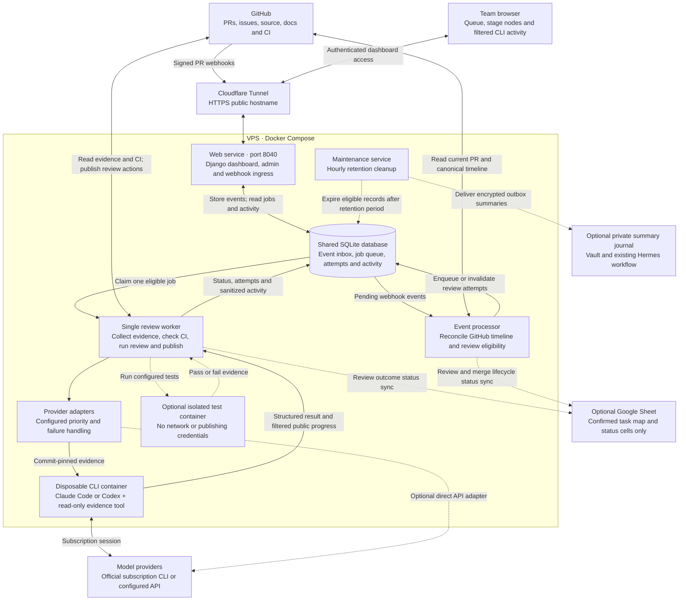
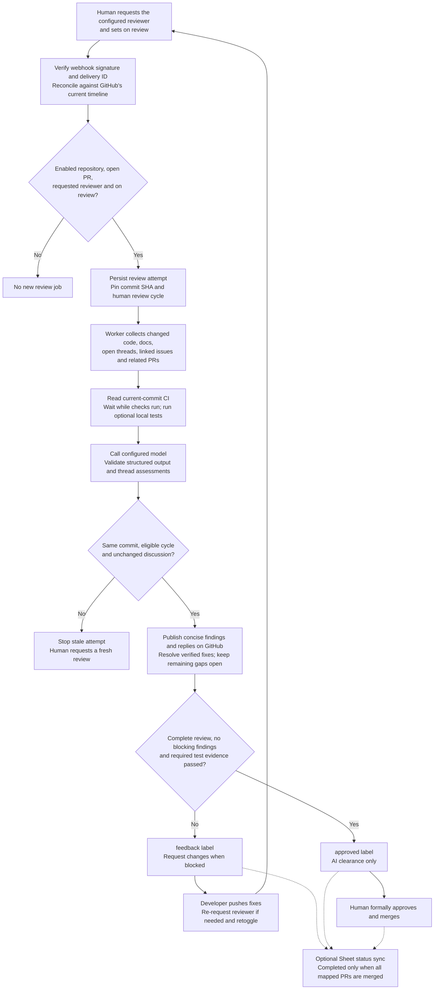

# Auto Reviewer

Self-hosted, label-driven GitHub reviews with an organization-isolated queue dashboard.

**Initial target:** `MarkAny-GaneshaIT/AnyOne-2.0`. **Public hostname:** `auto-reviewer.ainzw0rth.xyz`.

Operator activation steps: [.claude/operator-setup.md](.claude/operator-setup.md).
**Host origin:** `http://127.0.0.1:8040`.

GitHub holds review content. Dashboard members see job metadata only. Humans request runs;
pushes and replies never automatically start a review. One reviewer worker runs globally.

Context follows issues/PRs directly linked from the PR and confirmed task map, plus one hop
from those directly linked issues. Dependency issues are included as evidence but are not
recursively expanded into parent backlogs. Scope/size limits still block incomplete reviews;
recognized context failures show their specific safe cause in the job's operational note.

Read [the team workflow](.claude/team-auto-review-workflow.md) and
[the implementation plan](.claude/implementation-plan.md) before enabling live writes.

## Architecture and review flow

These Mermaid diagrams render directly in GitHub's README view. Solid arrows show the main
review path; dotted arrows show optional integrations or background activity.

### Components



- **GitHub is the collaboration surface:** findings, replies, request-changes reviews and thread
  resolutions live there. The dashboard shows progress, not review results.
- **The worker owns review publication.** Models return structured assessments; CLI containers do not
  receive GitHub credentials. The event processor also performs narrowly scoped lifecycle label
  cleanup and optional Sheet sync.
- **SQLite is the durable queue:** no Redis or separate message broker. Web, events, worker and
  maintenance are separate processes sharing the persistent data volume.
- **Access is organization-scoped:** members have read-only dashboard access; the configured owner
  can retry eligible attempts, and administrators manage connections and interrupt jobs.
- **Startup:** the one-shot `migrate` service applies schema migrations before the long-running
  services start. Cloudflare Tunnel is managed outside this project's Compose stack.

### One review cycle



**Exceptions and retries:** incomplete context stops the model review and blocks clearance.
A provider refusal or outage tries the next configured model. Incomplete CLI evidence gets one
fresh recovery pass prioritizing missing items, then falls forward if still incomplete. Exhausted
routes, authentication errors and other invalid output need attention. Quota exhaustion releases the worker and schedules a
retry on the same provider. Fresh CI and eligibility checks remain mandatory before clearance.
New commits or loss of eligibility invalidate active attempts; pushes and discussion replies alone
do not start another review. GitHub read/write operations are revalidated, but are not one atomic
transaction across GitHub and the local database.

For the detailed developer steps, see [the team workflow](.claude/team-auto-review-workflow.md).
Implementation entry points: [webhook ingress](core/webhooks.py), [event processing](core/events.py),
[review worker](core/worker.py), [publication guards](core/publication.py),
[CLI runner](core/cli.py), and [Sheet synchronization](core/sheets.py).

## Run locally on this VPS

Python 3.12+, Docker Engine/Compose and the project virtual environment are used. Versions
are pinned in `requirements.lock`; Docker base images are pinned by digest.

```bash
cd /root/projects/pr-review-service
# First install only; .env is created privately and never overwritten:
python3 -m venv .venv
.venv/bin/pip install -r requirements.lock
.venv/bin/python scripts/init_local.py

docker compose build
docker compose up -d
```

If `.env` already exists, skip `init_local.py`. The web listener binds only to loopback
port **8040**. Startup applies migrations through a one-shot migration service. Events,
worker and hourly cleanup run separately; cancellation processing is not blocked by a model call.

Production HTTPS redirects and secure cookies are enabled. Loopback `/healthz/` is exempt
from redirects. Do not disable production protections merely to use HTTP login.

### Cloudflare Tunnel

For a host-native `cloudflared`, route `auto-reviewer.ainzw0rth.xyz` to
`http://127.0.0.1:8040`. If your tunnel runs in Docker, `localhost` refers to its container;
attach it to the application network and route to `http://web:8040`, or configure an explicit
host gateway. Do not expose port 8040 publicly. Trust forwarded HTTPS headers only behind
this trusted proxy. The underscore spelling is not supported by Django host validation.

`.env` configures `ALLOWED_HOSTS`, `CSRF_TRUSTED_ORIGINS`, `PUBLIC_URL` and `TRUST_PROXY`.
The tunnel and DNS record are managed separately; this repository does not modify them.

### First administrator

```bash
docker compose exec web python manage.py bootstrap_admin --setup-link
```

This prints a private, one-use setup URL valid for one hour. Open it after the tunnel is
connected and choose a strong password. Initial username `louis`, email
`louiscaesapdf@gmail.com`; flags can change these. There is no default password. Rerunning
for an unfinished bootstrap invalidates its old link; existing configured admins are not overwritten.

Interactive bootstrap is also available without `--setup-link`. For recovery:

```bash
docker compose exec web python manage.py access_link --user louis --hours 1
```

Treat setup/reset/invite URLs as secrets. Do not paste them into public tickets or commit them.

## Configure connections in `/admin/`

1. Create the `ganeshait` organization.
2. Create credentials (secret field is write-only and encrypted in the database).
3. Create the repository with exact `owner/name`, Louis's exact GitHub username, GitHub
   credential and an independent random webhook secret credential.
4. Configure required GitHub check/status names and/or a pinned local test image/command.
5. Add model providers, exact model IDs and their priority.
6. Optionally configure Google Sheets using the confirmed mapping below.
7. Generate invitations from the Organization admin action. Members receive no platform-admin rights.

### GitHub account

Use an authorized token for Louis's account, restricted to the target repository where possible.
The integration needs repository contents/metadata and checks/statuses read access, and PR/issues
write access for comments, review threads, request-changes and workflow labels. Configure any
organization authorization requirements. Creating the webhook separately requires repository
administration rights. Do not copy credentials out of another agent's private session files.

Create repository labels `on review`, `feedback`, `approved`. Register webhook:

```text
https://auto-reviewer.ainzw0rth.xyz/webhooks/github/<repository-id>/
Content type: application/json
Secret: the matching webhook secret configured in Credentials
Events: Pull requests
```

Ingress verifies raw-body HMAC, repository identity and delivery ID. It stores only control
metadata; raw PR descriptions are not retained in the event inbox. Processing uses GitHub's
canonical issue timeline, not arrival order, to identify a review cycle.

Review content is posted through Louis's account and visibly marked automated. Formal `APPROVE`
is never submitted. Formal request-changes is permitted; GitHub can remove the outstanding
review request, so developers may need to request Louis again before retoggling.

### Models and authentication

Supported adapters: **Anthropic Messages API**, **OpenAI Responses API**, **Claude Code CLI**,
and **Codex CLI**. API adapters use API keys; CLI adapters use the official CLI's subscription
login in a dedicated private Docker volume. Never paste subscription tokens into API-key fields.
Use exact model IDs verified with your account; display names do not establish availability.
See [CLI runner setup](.claude/cli-runner-operations.md) for image building, login, probes and recovery.

CLI runners have no GitHub credentials, shell tools, arbitrary file access or external write tools.
They receive collected commit-pinned evidence through one read-only MCP tool. Results require
successful CLI exit, structured schema validation and complete evidence delivery. Delivery counters
prove tool activity, not model reasoning or review correctness. The trusted worker remains solely
responsible for eligibility, CI and publication. No silent fallback from subscription to paid API.

Outage errors may fall through the configured priority. Quota errors do not: dashboard shows
Out of quota, retains the selected provider, releases the worker and shows reset/next-check time.
Unknown reset time defaults to a check 30 minutes later. Provider refusals try the next configured model with the unchanged request, once per model
per pass. Incomplete CLI evidence gets one additional fresh-session recovery pass on that model, with missing
artifact IDs prioritized. Every pass must independently deliver the full evidence; prior coverage is
never reused. If coverage remains incomplete, the next configured model is tried. Dashboard model
attempts label this **Incomplete evidence** and identify the recovery pass. This exception does not
rotate on malformed output, authentication errors or quota exhaustion. Exhausting the route pauses
for admin inspection. Authentication/other invalid-output failures also require attention.

Each model call retains its status, timestamps and allowlisted diagnostics in the Job admin's
**Model attempts** section. The latest response also appears in **Provider diagnostics**
field in platform admin: HTTP status, recognized stop reason/refusal category, bounded token
counts and validated provider request/message IDs when available. Member pages/activity feeds
do not expose this field. Raw responses, private reasoning, final review text, prompts and credentials are never
stored as activity. Only explicitly public CLI progress excerpts use the filtered transcript. Each provider attempt clears stale diagnostics before calling; network failures without
a response have no response metadata. Historical attempts cannot be backfilled from discarded
responses; any separately recorded diagnostic replay must be identified as such.

There is no configured monthly spend cap or whole-review timeout. API calls have finite
network timeouts; CLI reviews have no service-imposed wall-clock timeout. Failure traversal is bounded. Interrupting a job cannot undo provider charges
already incurred. API cancellation may wait for a network timeout; CLI cancellation removes its runner container.

### Required checks and isolated tests

`required_checks` is a JSON list of exact GitHub check/status names. Every required check must
succeed on the reviewed SHA; pending/missing checks block clearance. Same-SHA CI evidence is
rechecked before clearance. An empty list without configured local tests does not provide enough
test evidence to approve automatically.

Optional local tests use `test_image` (digest-pinned) and `test_command` (argument array), e.g.:

```json
["python", "-m", "unittest", "discover"]
```

Prebuild and pull the image with needed dependencies. The test container has no network,
publishing credentials, Docker socket or host bind mounts. Source is validated and streamed
into bounded tmpfs. Nonroot UID, readonly root filesystem, dropped capabilities, 1 CPU/1 GiB
memory and PID limits apply. Images need `/bin/sh` and `tar`; images declaring volumes are rejected.
Test logs are not retained or displayed; reviews receive pass/fail evidence only.

The **trusted worker** has Docker-daemon access to launch containers; the test containers do not.
Treat operator access to that worker as privileged. No model tool allows arbitrary host commands.
On worker recovery, only test containers carrying this application's ownership label are removed.

## Optional Google Sheet

Disabled when `sheet_config` is empty. Team creates GitHub issues manually. Share the Sheet with
a Google service account and store its JSON privately in Credentials. Select it as the repository's
Sheet credential. Only designated issue status cells may be written.

Onboarding uses an **explicit admin-confirmed mapping**. Start with only the connection fields:

```json
{"spreadsheet_id": "YOUR_SHEET_ID", "range": "Tasks!A1:D"}
```

Read the actual headers, existing statuses and a status-cell dropdown sample:

```bash
python manage.py inspect_sheet REPOSITORY_ID
# For nonstandard or ambiguous header names:
python manage.py inspect_sheet REPOSITORY_ID --id-column "Task key" --status-column "Workflow"
```

This command uses a read-only Google scope, prints an **unconfirmed** proposal, and never saves
configuration or writes to the Sheet. It does not infer task/PR links. Review the sampled dropdown
and select the actual outcome mappings; every target cell's dropdown is checked again before writes.
The complete confirmed configuration looks like this (replace all examples):

```json
{
  "confirmed": true,
  "spreadsheet_id": "YOUR_SHEET_ID",
  "range": "Tasks!A1:D",
  "headers": ["ID", "Title", "Status", "Target date"],
  "id_column": "ID",
  "status_column": "Status",
  "allowed_statuses": ["Backlog", "In review", "Changes requested", "Ready to merge", "Done"],
  "statuses": {
    "review": "In review",
    "feedback": "Changes requested",
    "ready": "Ready to merge",
    "done": "Done"
  },
  "tasks": {
    "TASK-42": {"issue": 42, "prs": [51, 52]}
  }
}
```

The range begins at A1/A and includes the header. For a timeline with title rows, set
`"header_row": 3` (defaults to 1). Keep the range starting at A1; absolute row numbers are
preserved when locating and updating status cells. Headers on that row must be unique/nonempty.
`allowed_statuses` is the complete, confirmed
explicit dropdown (`ONE_OF_LIST`) vocabulary, including values such as Backlog that the service
never writes. It must contain every mapped status. If omitted, it defaults to the unique mapped
values for backwards compatibility. Multiple nonterminal outcomes may share a real value—for
example, both `review` and `ready` can map to In review. The `done` value must remain distinct so
an incomplete task cannot receive the completed value.

The real header and full dropdown vocabulary must match the confirmed mapping. Existing cells
may contain any allowed value. Row reordering is safe because writes find unique stable task IDs;
ambiguous/missing IDs or schema/status changes pause synchronization.

AI may inspect linked issues and related PRs, but task writes require the explicit confirmed map.
A nonempty required-PR set completes only when every PR is merged. Closed-unmerged/draft/open PRs
cannot complete a task. Humans maintain the required set when PRs are abandoned or replaced.

Status synchronization rechecks the source and review attempt before writing. Google Sheets has
no compare-and-set for a cell: a narrow concurrent-human-edit race remains between final reread and
write. Do not give the service ownership of requirements, target dates or other task columns.

## Dashboard and invitations

Displayed timestamps use **Asia/Jakarta — WIB (UTC+7)** across the queue, job timeline,
live activity, invitation expiry and administrator pages, regardless of the browser's timezone.
Stored timestamps and machine-readable API timestamps remain timezone-aware UTC; retry scheduling
and elapsed durations are unchanged.

Each attempt page includes a read-only **Review activity** panel. It polls every three seconds
while visible, showing timestamped real operations: context-file/document counts, CI and local
test checks, provider calls/fallback/quota, validated-response/findings counts, publication and
optional Sheet synchronization. Pause/resume affects only the display, never the worker.

A separate worker-process heartbeat updates every ten seconds during a running attempt,
including while waiting on a blocking API call. It is **not** a model token stream or proof of
remote inference progress. The UI flags heartbeat delays and feed disconnections separately.
No chain-of-thought, prompts, raw model output, source text, credentials or terminal commands
are stored in this feed. Review explanations/findings still appear only on GitHub.

Activity uses the same organization access checks as job details. Up to 300 predefined events
are retained per job (latest 100 displayed); they cascade-delete with 90-day terminal-job cleanup.
Attempts predating this feature have no historical activity log. Current status, provider,
start/finish times, operational note and quota retry time update without a page reload.

Members see only their organizations' PR links, commits, trigger actor, status, timestamps and
sanitized operational messages. Job details link back to GitHub; there is no review-results view.
Queue positions are organization-visible positions, not a leak of another organization's work.

Invite/reset links are single-use, expiring and revocable. Invitations grant dashboard membership,
not GitHub membership. Remove membership in admin to revoke access. Removing someone from GitHub
alone does not revoke their dashboard membership. Login throttling uses account + direct peer;
behind the tunnel the peer bucket may be shared (100 attempts/15 minutes). No email delivery required.

## Operations

```bash
docker compose ps
docker compose logs --tail 100 web events worker
docker compose exec web python manage.py check --deploy
docker compose exec web python manage.py backup
docker compose exec web python manage.py cleanup
```

Backups use SQLite's consistent backup API under `/app/var/backups/`. Securely copy them off-VPS,
with a **separate encrypted backup of `.env`/CREDENTIAL_KEY**. Losing the encryption key makes stored
credentials unreadable. To restore, stop worker/events/web/maintenance, preserve the current volume,
replace only its database with the selected backup, restore matching keys and restart/migrate. Never
copy a live SQLite file without its transaction state; use the backup command.

Hourly maintenance removes terminal jobs/receipts after 90 days and expired operational records.
Active/quota/attention jobs are not silently expired. Worker restarts mark interrupted jobs Needs
attention rather than automatically replaying uncertain publication. Inspect GitHub before retoggling.

## Development verification

```bash
.venv/bin/pip install -r requirements.lock ruff
.venv/bin/python manage.py test --noinput
.venv/bin/ruff check core reviewdesk manage.py scripts
.venv/bin/ruff format --check core reviewdesk manage.py scripts
DJANGO_SECRET_KEY=local-check-only .venv/bin/python manage.py makemigrations --check --dry-run
```

Tests use a temporary database and fake external transports; no production reviews or API charges.
Local browser-smoke artifacts live under ignored `.claude/verification/` and `var/`.

## Before enabling real reviews

`LIVE_WRITES=0` is the shipped default. No real external comments or Sheet writes were used to
validate this release. Set `LIVE_WRITES=1` and recreate services only after:

- GitHub credentials, exact reviewer username and webhook signature delivery are verified.
- Formal review/request-removal behavior is checked on a dedicated test PR.
- Your exact models/authentication and required check configuration are verified.
- Optional Sheet mapping and permissions are confirmed.
- Hostname/tunnel/login and administrator access work.

Use a dedicated test repository first. Admin configuration deliberately starts empty; model IDs,
organization secrets and example task mappings are never invented or pre-enabled.

### Live review workflow

The read-only job page shows connected stage nodes: file and documentation counters, discussions,
CI, optional tests, ordered model attempts, and GitHub publication. Each model call has its own
result and duration. Quota checks remain on the selected provider. Detailed events are collapsed
by default. Historical jobs show only recorded evidence; deployment does not resume them.

### Owner-only dashboard retries

Set `DASHBOARD_RETRY_USER_ID` to the existing owner's Django user ID (default `0` disables).
The account must also be active and a superuser. Other admins and members cannot use this action.
On an eligible job detail page, **Retry review** creates a fresh attempt from the first model.
The server rechecks the current GitHub commit, reviewer, label and canonical human review cycle.
Stale, running, completed or already-published attempts cannot be retried this way. No label is
added automatically. Double-clicks redirect to the same new attempt. Model errors show safe
HTTP/classification details; insufficient Anthropic API credits are quota, including HTTP 400.

### Dashboard refresh and subscription routing

The dashboard and native admin share warm-paper/charcoal design tokens, self-hosted Martian Mono
(with bundled OFL license), control sizes and responsive layouts. Queue filters apply automatically:
repository search is debounced, status/requester selection is immediate, and pagination preserves
all filters. Requester means the recorded GitHub trigger actor for that attempt, not necessarily
the PR author. Options and results remain organization-scoped. Without JavaScript, a submit fallback
is available.

Job detail retains workflow nodes and adds an always-visible terminal-style operational feed with
pause/follow controls. It shows fixed, allowlisted CLI lifecycle/evidence events, never raw stdout,
private reasoning, credentials, source content or review findings. New events begin with new review
activity; old attempts cannot acquire a retrospective CLI transcript.

Changed-file, relevant-document and supporting-source counts no longer have hard caps. Relevance
selection is unchanged; this is not a whole-repository audit. Collection retains an explicit 32 MiB
JSON evidence budget; CLI transport permits 128 MiB including serialization overhead, while API
adapters retain their smaller request budget. GitHub limits, binary/unreadable content and model
resource/context limits still fail visibly; no partial evidence is silently treated as complete.

Claude subscription authentication and both configured Opus model IDs have been probed successfully.
Explicit native refusal signals stop the runner immediately, and the worker follows the existing
ordered route. No request rewriting, automatic GitHub approval or API-billing fallback is introduced.

### Actual CLI transcript and concise GitHub reviews

**CLI output** is now distinct from **Worker events**. The default terminal tab displays native
Claude/Codex session events, explicitly public one-line assistant progress, and actual evidence-tool
start/completion/failure events with filenames and requested ranges. The worker tab retains queue/
collection/CI/publication milestones. Display refresh remains every three seconds; timestamps record
when the service receives events, not token-level latency. Silent periods are not filled with fake text.

Only assistant text explicitly tagged for public progress is exported. Reasoning/thinking blocks,
final review JSON, unmarked assistant output, raw tool-result contents and arbitrary stderr are excluded.
Common credential formats and URLs are redacted; text is bounded and rendered as plain text. This is
not a raw terminal mirror. Public excerpts are stored as organization-scoped JobActivity records under
the same job retention; older attempts have no retroactive transcript. The recent-event window remains
bounded. Provider/model labels distinguish consecutive fallback sessions.

Review instructions now follow the concise style of the supplied #137/#142 examples: exact code
identifier and failing condition, concrete impact, smallest correction; one actionable issue per
finding. Code identifiers, file paths, routes/config values and expressions use Markdown backticks.
Same-repository references use native #number mentions when present in evidence. Summaries avoid
repeating inline findings. Existing comments are not rewritten, and model output still needs human
review; this changes the review instructions rather than guessing code spans with a prose regex.

### Follow-up discussion resolution

Each triggered review assesses every open current-PR review thread. Verified fixes receive a concise
commit-linked explanation and GitHub thread resolution; remaining gaps receive a reply and stay
open. Human-authored threads are included, but related-PR threads and ordinary PR comments are not
resolved. Fresh commit/eligibility/comment checks prevent stale publication. Push fixes, then
re-request the reviewer if needed and retoggle `feedback` → `on review`.

The worker waits for running CI before calling the model, then refreshes required CI before
publication. The dashboard uses the latest observed CI result, not an earlier pending snapshot.

### Host configuration and activity tracking

Review CLIs run in disposable Docker containers, not the host's interactive work/personal profiles.
Only the selected service auth volume is mounted. Personal settings, hooks and tracking sender
state from `Ainzw0rth-config` are not mounted or loaded.

The service can submit **final review summaries** to the same journal through its submission API,
without enabling host hooks inside CLI containers. Completed runs include the published review's
summary, finding/thread counts, model, outcome and PR/job links. Unsuccessful runs include only
operational status and links, not rejected model output. It does not send prompts, private reasoning,
source files, raw CLI transcripts or individual finding/thread bodies. This is summary journaling,
not full activity capture. Historical runs are not automatically imported.

To enable, create an encrypted Credential using the journal's **submission-only** token, then set:

```dotenv
JOURNAL_ENABLED=1
JOURNAL_ENDPOINT=https://tsunagu.ainzw0rth.xyz/api/v1/sessions
JOURNAL_CREDENTIAL_ID=<credential database ID>
JOURNAL_REPOSITORIES=MarkAny-GaneshaIT/AnyOne-2.0
```

Only explicitly listed repositories are captured or delivered. The worker queues summaries in an
encrypted SQLite outbox. Maintenance retries up to eight entries each minute, with five-second
network timeouts. Stable event IDs prevent duplicates on the receiving backend. An outage never
changes a review's GitHub outcome. Entries above the backend's 64 KiB summary limit are rejected,
not silently truncated; a capture-warning activity event appears if capture fails.

**Admin → Journal entries** shows queued/accepted delivery metadata and safe errors; payloads are
not exposed there or to dashboard members. Successful acknowledgment clears the local encrypted
payload; delivery receipts expire after 90 days. Pending deliveries survive job-history cleanup.
The remote journal/vault has its own retention policy. `JOURNAL_ENABLED=0` stops both new capture
and delivery of pending entries. No credentials or journal sender state enter model containers.

```bash
docker compose exec maintenance python manage.py flush_journal
```

This retries pending delivery without printing summary contents. The same backend exports accepted
notes for the existing vault/Hermes workflow. No shared client configuration changes are required.
