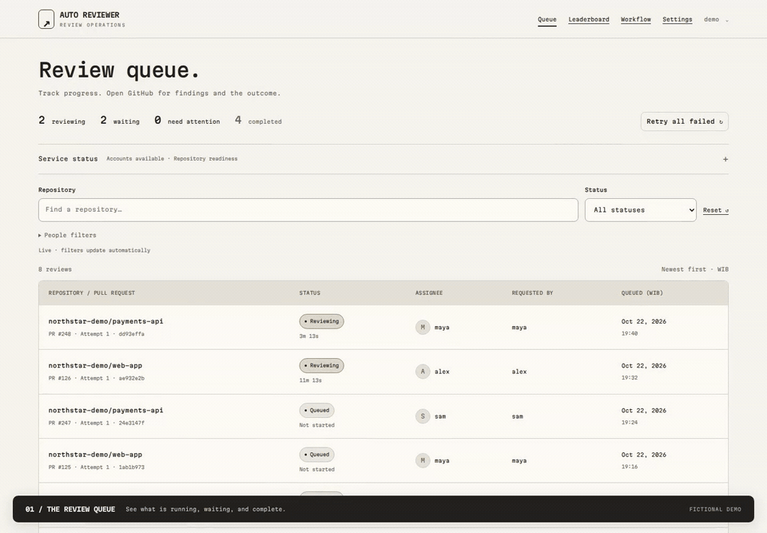
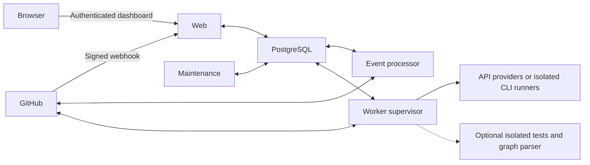

# Auto Reviewer

Self-hosted, human-triggered GitHub PR reviews. An organization-scoped dashboard shows
queue progress, model activity and operational status; findings stay on GitHub.

## See it in action

https://github.com/user-attachments/assets/f5076541-22b4-4033-9634-7cf2e4782a4a

[Screenshots & local demo](docs/demo.md)

Queue → specialist progress → repository settings. Real UI, fictional data; no customer
information or real review results. Silent video with on-screen captions.

<details>
<summary>Play a short animated preview</summary>



</details>

## What it does

- **Explicit review requests:** request the configured reviewer and apply `on review`.
  Pushes and discussion replies alone do not start reviews.
- **Grounded review:** commit-pinned changes, linked issues, documentation and optional
  dependency-graph evidence; code, security and test specialists followed by adjudication.
- **Your model connection:** Anthropic/OpenAI APIs or authenticated Claude Code/Codex CLI runners.
- **Controlled publication:** feedback and workflow labels by default. Formal approval and
  automatic merging are separate, opt-in repository settings, disabled initially.
- **PostgreSQL-backed queue:** one worker supervisor manages configurable concurrent PRs
  and separate provider/resource limits. No Redis required.

## Start here

With Docker Compose and Python 3 installed, run this from a fresh checkout:

```sh
python3 scripts/setup.py
```

**Start → connect model → add repository → first review.** The wizard handles containers,
private configuration, administrator setup and model registration. You complete account
login, then add your repository in Settings. No separate host CLI installation needed.

[Follow the three-step quickstart](docs/quickstart.md). GitHub publication starts disabled;
the final step explicitly enables it. Existing installation? Use the deployment guide instead.

| Guide | Contents |
| --- | --- |
| [Quickstart](docs/quickstart.md) | Guided setup and your first review |
| [Manual installation](docs/installation.md) | Localhost, HTTPS server, first login, public webhook forwarding |
| [Configuration](docs/configuration.md) | Add/Edit/Pause repositories, credentials, providers, review behavior |
| [Remote workers](docs/workers.md) | Add an outbound-only execution host; independent local provider login |
| [Deployment](docs/deployment.md) | Proxy, concurrency, drained updates, backups and recovery |
| [Optional integrations](docs/optional-integrations.md) | Google Sheets, summary journal, Telegram and graphs |
| [Troubleshooting](docs/troubleshooting.md) | Startup, login, webhook, provider and queue diagnostics |
| [Existing SQLite migration](docs/postgres-cutover.md) | Supervised transfer of an existing installation |

For an additional execution host (not another coordinator):

```sh
python3 scripts/setup.py --mode worker --state-dir /data/review-worker
```

Standalone remains the default. Worker setup requires a coordinator HTTPS origin and
owner-issued pairing code; it does not create a database or dashboard. [Worker guide](docs/workers.md).

## Architecture



The trusted worker has Docker-daemon access. Disposable model, test and graph containers
never receive that socket or GitHub publishing credentials. Credentials and retained analysis
checkpoints are encrypted; protect both the database and `.env` encryption key.

## Development

Python 3.12+ with dependencies from `requirements.lock`; PostgreSQL for worker integration.
SQLite remains available for isolated tests, not the recommended service deployment.

```sh
python3 -m venv .venv
.venv/bin/pip install -r requirements.lock
.venv/bin/pip install ruff==0.16.10  # Development checks only
.venv/bin/python manage.py test --noinput
.venv/bin/ruff check core reviewdesk manage.py scripts
.venv/bin/ruff format --check core reviewdesk manage.py scripts
DJANGO_SECRET_KEY=local-check-only .venv/bin/python manage.py makemigrations --check --dry-run
```

These checks do not authenticate providers or publish reviews. Live end-to-end verification
requires your own repository, credentials and explicit enablement.
