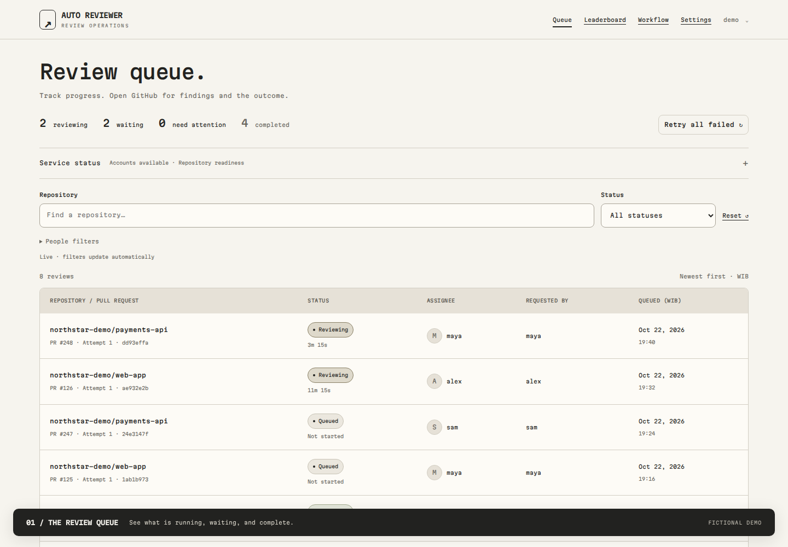
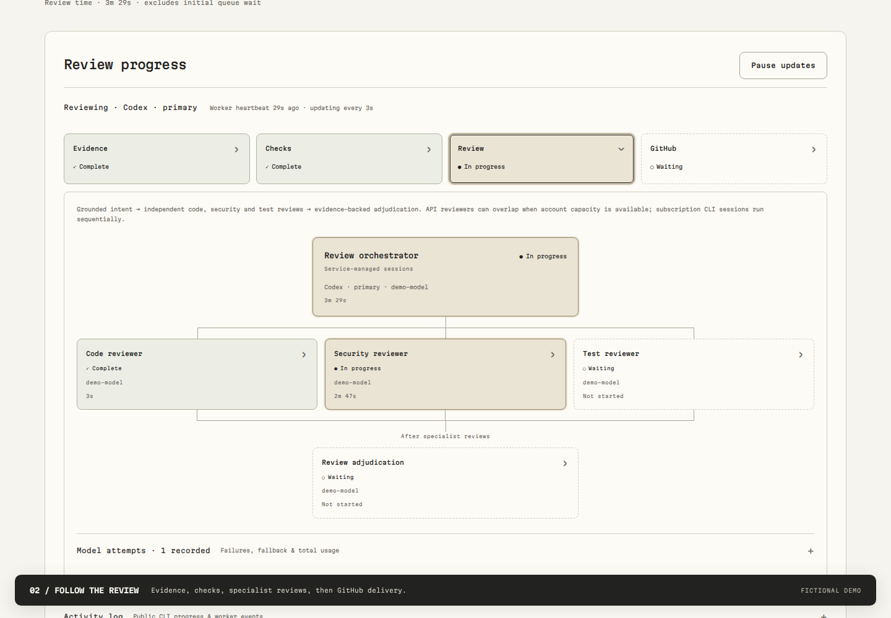
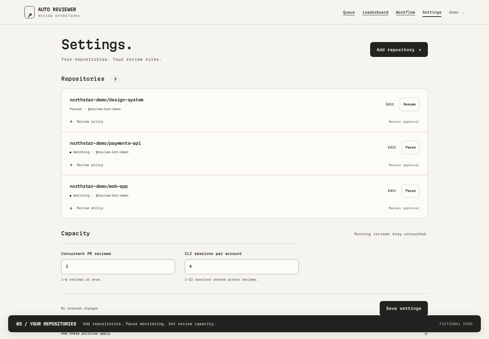

# Product demo

https://github.com/user-attachments/assets/f5076541-22b4-4033-9634-7cf2e4782a4a

[Animated preview](media/demo-preview.gif) · [Quickstart](quickstart.md)

Real application screens, **fictional data**. Repository names, people, model IDs,
activity, quota values and timings are illustrative—not customer data or performance
benchmarks. No actual reviews were run or published during recording.

## What you see

1. **Queue:** running, waiting and completed reviews; filter by status.
2. **Review progress:** evidence, CI, specialist assessments and delivery stages.
3. **Public activity:** operational updates, not private reasoning or raw model output.
4. **Settings:** watched/paused repositories, review policies and capacity.
5. **Add repository:** configure a connection without editing source code.

The video is silent, with on-screen captions. These stills show the same product without motion:

### Review queue



### Specialist progress



### Repository settings



## Run the fictional demo locally

Use the [development environment](../README.md#development), then:

```sh
.venv/bin/python scripts/demo.py
```

Open **http://127.0.0.1:18041**. Sign in with `demo` / `demo-review-only`.
These credentials exist only in this disposable local demo.

- Uses a fresh temporary SQLite database under `var/`, not your deployment database.
- Ignores `.env` and replaces inherited application configuration.
- Starts only the web interface on loopback—no workers or Docker runners.
- Blocks Python outbound connections and restricts browser requests to the local origin.
- Uses fictional activity snapshots; it is not a live review engine.
- Stops with Ctrl+C. No production migration, login or provider connection is needed.

Do not expose this demonstration server publicly. It is intentionally a local development tool,
not another supported production deployment method. No demo account is added to the real app.

## GitHub video player

The README and this page embed a GitHub-hosted video attachment, playable directly on GitHub
with native playback controls. The attachment URL must occupy its own paragraph to render as
a player. Keep the local MP4 as the source; after replacing it, upload the new recording to
GitHub and update the attachment URL in both Markdown files.

The [standalone player](https://ainzw0rth.github.io/pr-review-service/) remains an optional fallback.
Its source is [`demo.html`](demo.html), published as `index.html` on the `gh-pages` branch with
`media/demo.mp4`, `media/review-progress.png` and `.nojekyll`. This branch does not deploy the app.

## Regenerate the media

Keep the demo running in one terminal. In another, install **development-only** capture tools
(Node.js/npm, Playwright Chromium and FFmpeg). They are not application dependencies:

```sh
npm install --prefix var/demo-tools --no-save --package-lock=false playwright
var/demo-tools/node_modules/.bin/playwright install chromium
PLAYWRIGHT_MODULE="$PWD/var/demo-tools/node_modules/playwright" node scripts/capture_demo.cjs
```

The recorder signs in only to the fixed local demo address, checks for fictional data,
blocks external browser requests, and exercises the real UI. It saves three PNG screenshots
to `docs/media/` and a raw recording to `var/product-demo/walkthrough.webm`.
It fills—but does not submit—the Add repository form.

With `ffmpeg` installed, encode a broadly playable MP4:

```sh
ffmpeg -y -i var/product-demo/walkthrough.webm -an \
  -c:v libx264 -preset slow -crf 24 -pix_fmt yuv420p -movflags +faststart \
  docs/media/demo.mp4
```

Generate a short preview from three portions of the recording:

```sh
ffmpeg -y -i docs/media/demo.mp4 -filter_complex \
  '[0:v]trim=1:4,setpts=PTS-STARTPTS[a];[0:v]trim=15:19,setpts=PTS-STARTPTS[b];[0:v]trim=27:30,setpts=PTS-STARTPTS[c];[a][b][c]concat=n=3:v=1:a=0,fps=8,scale=960:-1:flags=lanczos,split[p][q];[p]palettegen=max_colors=96:stats_mode=diff[pal];[q][pal]paletteuse=dither=bayer:bayer_scale=3' \
  -loop 0 docs/media/demo-preview.gif
```

Review the resulting frames before publishing. If UI timing or layout changes, adjust the
preview segments. Keep production screenshots, browser sessions and credentials out of Git.
